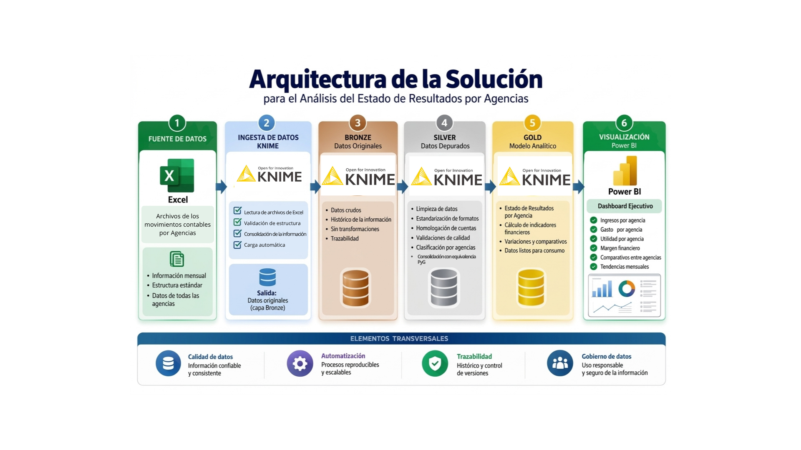
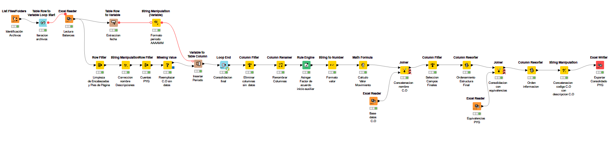
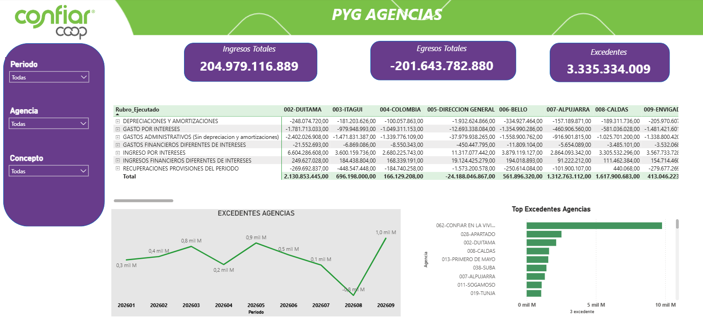

# Solución de Big Data para el análisis del PyG de las Agencias de Confiar

**Estudiantes:** Paola Duque Cardona
                 Ana Carolina Osorio 
                 Yuliana Gomez Franco
# 1. Caso de Negocio

## 1.1. Descripción del problema

En las entidades financieras se generan grandes volúmenes de información contable que requieren procesos de extracción, transformación, clasificación y análisis para convertir los datos en información útil para la toma de decisiones. 
En Confiar Cooperativa Financiera, la información contable es gestionada mediante el ERP institucional, el cual registra los movimientos contables generados por las diferentes Agencias. De forma mensual, el sistema genera informes de libros auxiliares que contienen el detalle de cada movimiento contable realizado durante el período.
Aunque estos reportes constituyen una fuente valiosa de información para el análisis financiero, su estructura está orientada al registro y control contable, por lo que requieren procesos adicionales de depuración, clasificación, consolidación y agrupación para facilitar su interpretación desde una perspectiva gerencial.

Actualmente, la transformación de estas bases de datos representa una oportunidad de mejora en términos de eficiencia operativa, estandarización de procesos y oportunidad de la información en tiempo real para el seguimiento diario de las metas.

Por lo anterior, se plantea desarrollar una solución de procesamiento y analítica de datos que permita automatizar la transformación de los libros auxiliares contables, estructurar la información y facilitar la construcción del estado de resultados (PyG) por cada una de las Agencias en su respectivo periodo, mediante herramientas de analítica de datos y visualización.

## Objetivo General
Diseñar e implementar una solución para el procesamiento y análisis de datos que permita automatizar la transformación, clasificación y consolidación de los movimientos contables de Confiar Cooperativa Financiera, con el propósito de facilitar la construcción y análisis del estado de resultados por agencias y periodos, apoyando la toma de decisiones mediante herramientas de analítica y visualización.

## Objetivos Específicos
 - Analizar la estructura y composición de los libros auxiliares contables generados por el ERP de Confiar Cooperativa Financiera, identificando las variables necesarias para la construcción del estado de resultados.
 - Diseñar un proceso de transformación de datos que permita clasificar y asociar las cuentas contables a las categorías de ingresos, gastos y demás componentes requeridos para el análisis financiero por agencia.
 - Implementar un flujo automatizado de procesamiento de datos mediante la herramienta KNIME para la integración, depuración y consolidación de la información proveniente de múltiples períodos contables.
 - Desarrollar un tablero de visualización que facilite el seguimiento de los resultados financieros por agencia, período y concepto contable, apoyando la toma de decisiones organizacionales.

## 1.4. Alcance del proyecto

El proyecto comprende el procesamiento de los libros auxiliares contables correspondientes a los periodos analizados de Confiar Cooperativa Financiera, con el propósito de estructurar y consolidar la información necesaria para la construcción del estado de resultados (PyG) por agencia.

La solución comprende las siguientes actividades:

- Ingesta e integración de los archivos contables provenientes del ERP institucional.
- Consolidación de los archivos que contienen la información contable.
- Validación de la estructura y calidad de los datos.
- Limpieza y estandarización de los campos necesarios para el análisis.
- Clasificación y agrupación de cuentas contables según los criterios del PyG.
- Consolidación de los movimientos por agencia y periodo.
- Construcción de la estructura de datos para la elaboración del estado de resultados.
- Automatización del procesamiento mediante KNIME.
- Visualización de los resultados a través de un tablero en Power BI.

## 1.5. Justificación

La transformación de datos contables en información estructurada permite reducir actividades manuales, mejorar la consistencia de los resultados y facilitar el análisis de la información financiera.

se utilizará KNIME como herramienta principal para diseñar y ejecutar el flujo de transformación de datos, permitiendo automatizar tareas repetitivas y garantizar una estructura de información estandarizada. 

Posteriormente, los datos procesados serán visualizados en Power BI mediante un tablero interactivo que facilite la consulta y el análisis de los resultados financieros.

De esta manera, el proyecto busca convertir datos contables dispersos en información útil para la toma de decisiones, aplicando técnicas de analítica de datos para mejorar la eficiencia del proceso y fortalecer la disponibilidad de información financiera para las diferentes áreas de la organización.

# 2. Relación Beneficio Coste

# 2.1 Análisis económico 

El análisis de la relación beneficio-coste tiene como propósito identificar y evaluar los beneficios económicos, operativos y estratégicos que puede generar la implementación de una solución de Big Data para la transformación y análisis del estado de resultados (PyG) por agencias de Confiar, con el propósito de optimizar el procesamiento de la información contable de la cooperativa mediante la automatización de actividades de extracción, limpieza, transformación y consolidación de datos, utilizando KNIME como herramienta de procesamiento y Power BI como herramienta de visualización.

A partir de esta solución se espera reducir significativamente las actividades manuales, mejorar la oportunidad en la disponibilidad de la información a las diferentes áreas y Agencias, igualmente se busca facilitar el consolidado de la información financiera de toda la cooperativa.

# 2.2 Beneficios económicos, operativos y estratégicos

- Reducción significativa del tiempo destinado a la consolidación del informe mensual de los movimientos contables.
- Disminución de actividades repetitivas relacionadas con la agrupación de cuentas.
- Transformación del análisis operativo a la gestión estratégica, facilitando el monitoreo oportuno de los principales ingresos y gastos.
- Reducción de reprocesos asociados a errores en la consolidación de información manual.
- Mayor capacidad para procesar volúmenes de información de manera estructurada, teniendo en cuenta que Confiar se encuentra en expansión de Agencias.
- Disponibilidad de información financiera organizada por agencia y periodo.
- Identificación de comportamientos y tendencias en los resultados financieros de cada Agencia.
- Automatización del proceso en la medida que se amplíen nuevos rubros contables y oficinas.

# 2.3 Estimación relación beneficio- coste

El principal beneficio cuantificable será el ahorro de tiempo operativo, debido a que la automatización permitirá disminuir la intervención manual en las actividades de consolidación, transformación y clasificación de los movimientos contables.

Actualmente, estos informes implican actividades de manipulación, revisión, clasificación y agrupación de registros provenientes de diferentes archivos. Estas tareas demandan tiempo operativo y pueden generar reprocesos cuando se presentan inconsistencias en la información. Adicionalmente, el beneficio esperado no se limita al ahorro de tiempo, sino que también comprende mejoras en la calidad, disponibilidad, trazabilidad y aprovechamiento de la información financiera.

*Figura 1. Coste/Beneficio*
# 3. Arquitectura propuesta

*Figura 2. Arquitectura de la solución*
# 4. Pipeline de ingesta de datos

Se implementó una arquitectura de datos basada en el modelo Medallion, estructurada en las capas Bronze, Silver y Gold. Este enfoque permite gestionar los datos de manera estructurada desde su origen, realizar los procesos de transformación que se requieren, y disponer finalmente de información confiable para el informe del Estado de Resultados por agencias.

 **Bronze**: corresponde a la capa de entrada, donde se reciben los archivos contables provenientes del ERP, conservando la información de origen.

**Silver**: comprende los procesos de limpieza, depuración, estandarización y transformación de los datos, garantizando una estructura homogénea y consistente.

**Gold**: contiene la información consolidada y estructurada para el análisis financiero, permitiendo la construcción del estado de resultados (PyG) por agencias y periodos.

# 4.1. Diseño del pipeline de ingesta

El pipeline se diseñó para consolidar la información de los movimientos contables provenientes de nueve archivos Excel correspondientes al periodo enero-septiembre de 2026.

La fuente de información contiene aproximadamente 475.000 registros distribuidos en 14 columnas. Cada archivo corresponde a un periodo mensual y contiene los movimientos contables que serán utilizados como insumo para el análisis financiero.

A partir de esta solución se espera reducir las actividades manuales, mejorar la oportunidad en la disponibilidad de la información para las diferentes áreas y Agencias y facilitar la consolidación de la información financiera de la Cooperativa.

# 4.2. Automatización de la ingesta mediante Workflow en KNIME

La automatización del proceso se desarrolló mediante KNIME, herramienta que permite diseñar y ejecutar workflows a través de nodos interconectados, encargados de realizar las diferentes operaciones de procesamiento y transformación de datos.

En este proyecto, el Workflow constituye la implementación técnica del pipeline diseñado, permitiendo integrar las actividades de lectura, estructuración, procesamiento y consolidación de los archivos contables dentro de un flujo de trabajo organizado. Cada nodo cumple una función específica permitiendo establecer una secuencia lógica de ejecución.

El Workflow desarrollado en KNIME integra los componentes necesarios para procesar los archivos contables y consolidar la información correspondiente al periodo de análisis.

*Figura 3. Workflow implementado en KNIME.*

Como resultado de esta etapa, se consolidó la información contable de los nueve meses analizados en una estructura única y homogénea, facilitando su exportación para la posterior visualización y análisis gerencial. La implementación del workflow en KNIME permite automatizar la integración de la información, facilitar su actualización periódica y reducir la intervención manual en el procesamiento de los archivos contables..

# 5. Modelo de ciencia de datos

El proyecto adopta un enfoque de analítica descriptiva y comparativa, orientado a identificar el comportamiento financiero de las agencias de Confiar a partir de los resultados de ingresos y gastos.

Este modelo busca visibilizar:
 1. El comportamiento de ingresos y gastos por Agencias.
 2. Variaciones entre cada uno de los periodos
 3. Los conceptos o rubros contables con mayor impacto en el PyG final de la cooperativa.

Los principales indicadores definidos para el análisis son:

- Total de ingresos por intereses.
- Total de gastos por intereses.
- Total de ingresos financieros diferentes de intereses.
- Total de gastos financieros diferentes de intereses.
- Recuperaciones provisiones del periodo.
- Gastos administrativos.
- Depreciaciones y amortizaciones. 
- Excedentes: resultado de la diferencia entre los ingresos y los gastos, de acuerdo con la estructura contable definida para el PyG.

Al interpretar los resultados, se debe tener en cuenta que la Dirección General registra el excedente más negativo. Esto obedece a que por política de la Cooperativa, esta unidad asume los gastos relacionados con la capacidad instalada, la infraestructura y el soporte corporativo que respaldan la operación de todas las oficinas, por lo que su resultado no es directamente comparable con el de las demás agencias.

# 6. Desarrollo del tablero de visualización en Power BI

*Figura 4. Tablero PowerBI*

Posterior al proceso de transformación y consolidación de los datos mediante KNIME, se desarrolló un tablero interactivo en Power BI, cuyo propósito es facilitar el análisis y seguimiento del Estado de Resultados (PyG) de las Agencias de Confiar Cooperativa Financiera.

El tablero permite convertir los movimientos contables procesados en información visual y estructurada, facilitando la interpretación de los resultados financieros y mostrando en tiempo real las cifras claves para el seguimiento de indicadores.

La herramienta permite interactuar con los datos mediante filtros y segmentaciones, facilitando el análisis desde diferentes perspectivas y niveles de detalle. De esta manera, los responsables de las Agencias pueden consultar el comportamiento de su PyG durante el periodo, identificar variaciones en los ingresos y gastos y contar con información que facilite la definición de acciones para mejorar su desempeño financiero.

La integración entre KNIME y Power BI permite establecer un proceso estructurado en el que la primera herramienta se encarga del procesamiento y transformación de los datos, mientras que la segunda facilita la visualización de la gestión financiera.

En términos gerenciales, esta solución contribuye a fortalecer la disponibilidad de información financiera, facilitar el seguimiento de los resultados y proporcionar elementos de análisis para apoyar la toma de decisiones para la gerencia.

# 7. Conclusiones

1. El desarrollo del proyecto permitió identificar y estructurar las variables necesarias para la construcción del Estado de Resultados a partir de los libros auxiliares generados por el ERP institucional. Mediante el proceso de depuración, estandarización y clasificación de las cuentas contables, se logró consolidar la información de nueve periodos mensuales, correspondientes a aproximadamente 475.000 registros. Esto permitió transformar archivos originalmente orientados al registro contable en una estructura organizada para el análisis y visualización financiera por Agencia y periodo.

2. La implementación del workflow en KNIME permitió integrar y automatizar las actividades de lectura, procesamiento, transformación y consolidación de los archivos contables. Esta solución establece un flujo de trabajo replicable y facilita la actualización de la información cuando se incorporan nuevos periodos, centros de costos, adicional que reduce la dependencia de actividades manuales y contribuye a disminuir los riesgos de errores y reprocesos asociados a la manipulación de múltiples archivos y formulas de excel.

3. La construcción del tablero en Power BI permitió disponer de una herramienta para consultar el comportamiento de los ingresos, gastos, margen neto de intereses y excedentes por Agencia y periodo. La integración de KNIME y Power BI demuestra cómo las herramientas de analítica de datos contribuyen al seguimiento y análisis gerencial, fortaleciendo la capacidad de identificar variaciones, comparar resultados y apoyar la toma de decisiones financieras en Confiar Cooperativa Financiera.

# 7. Referencias.

- Databricks. (s. f.). What is the medallion lakehouse architecture? https://learn.microsoft.com/en-us/azure/databricks/lakehouse/medallion
- KNIME. (s. f.). KNIME Analytics Platform documentation. https://docs.knime.com/ap/latest/
- Microsoft. (s. f.). Overview of Power BI reports. Microsoft Learn. https://learn.microsoft.com/en-us/power-bi/create-reports/power-bi-reports-overview.
